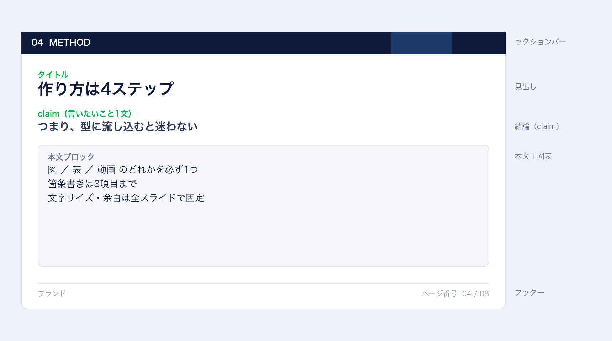

# スライドの設計

このキットの見た目は、ひとつの制約から逆算しています。

> **スライドは「読む資料」ではなく「見る資料」。**

読み手は前を向いたまま、1枚あたり数秒しか見ません。だから
「1枚に1つの主張」「文字は大きく少なく」「図は必ず1つ」になります。

## レイアウトの解剖



上から順に、**セクションバー → 見出し → 結論 → 本文＋図表 → フッター**。
この並びは全スライドで動きません。位置が固定されていると、聞き手は
「どこを見ればいいか」を毎回探さずに済みます。

| 領域 | 高さ（1920×1080 基準） | 役割 |
|---|---|---|
| セクションバー | 84px | 今どの話をしているか。番号＋英字ラベル |
| 見出し | 55px 前後 | 何のスライドか |
| 結論（claim） | 34px | この1枚で言いたいこと。**本文より先に置く** |
| 本文 | 残り全部 | 箇条書き／手順／数値／図表 |
| フッター | 62px | ブランドとページ番号 |

## なぜ「固定ステージ」なのか

1920×1080 のキャンバスを作り、JavaScript で `transform: scale()` して
画面に合わせます。ウィンドウを広げても狭めても、**文字サイズと改行位置は同じ**。

`vw` 単位で組むと、ノートPCでは小さく、外部モニタでは間延びします。
発表当日の機材で見え方が変わるのは避けたいので、固定にしています。

## タイポグラフィ

| 用途 | サイズ | 書体 |
|---|---|---|
| 表紙のキャッチ | 92px / 900 | ヒラギノ角ゴシック |
| 見出し | 55px / 800 | 同上 |
| 結論 | 34px / 700 | 同上 |
| 本文 | 28〜40px | 同上 |
| 数値 | 70px / 800 | Helvetica Neue 系（tabular-nums） |
| フッター | 18px | Helvetica Neue 系 |

和文はゴシック一択です（明朝は投影で細部が飛ぶ）。英数字だけ別書体にすると、
数字が揃って見えます。

## 色は2色まで

```
紺  #101a3d   見出し・バー・本文
緑  #00b34a   キーワードと数値だけ
```

グレーは背景と罫線だけ。**アクセント色を3色以上使うと、どこが大事か分からなくなります。**
彩度100%の色は投影で滲むので、この2色も少し落としてあります。

## 情報量のルール

- 箇条書きは **3項目まで**、各 **40文字以内**
- 1枚に主張は **1つだけ**
- 溢れたら **縮めずに2枚に分ける**
- 図・表・動画のどれかを **必ず1つ** 入れる

4項目目を足したくなったときは、たいてい2枚に分けたほうが伝わります。

## 図表の扱い

| 図の形 | 置き方 |
|---|---|
| 横長（2:1 以上） | 全幅の帯（`media.band: true`）。文字の下に敷く |
| それ以外 | 左右分割。文字と図を半分ずつ |
| 数値カードが3枚以上 | 図は省略（潰れるため） |
| 表があるとき | 表が主役。数値カードは出さない |

図は**切り取らずに** `object-fit: contain` で収めます。論文の図は情報が端まで
詰まっているので、`cover` で切ると意味が壊れます。

## よくある失敗と直し方

| 症状 | 直し方 |
|---|---|
| 下半分が空く | 図を帯に変える／本文を1段大きくする |
| 文字が入りきらない | 主張を削る。1文減らすだけで収ることが多い |
| 図が小さい | 左右分割をやめて全幅の帯に |
| スライドごとに見た目が違う | セクションと余白を固定しているか確認 |
| 何の図か分からない | 図に必ず出典を添える。無理なら図を捨てる |

## アクセシビリティ

- 色だけで意味を伝えない（緑は「強調」であって「正解」ではない）
- コントラストは 4.5:1 以上（紺 on 白は 12:1）
- アニメーションは `prefers-reduced-motion` で止まる
